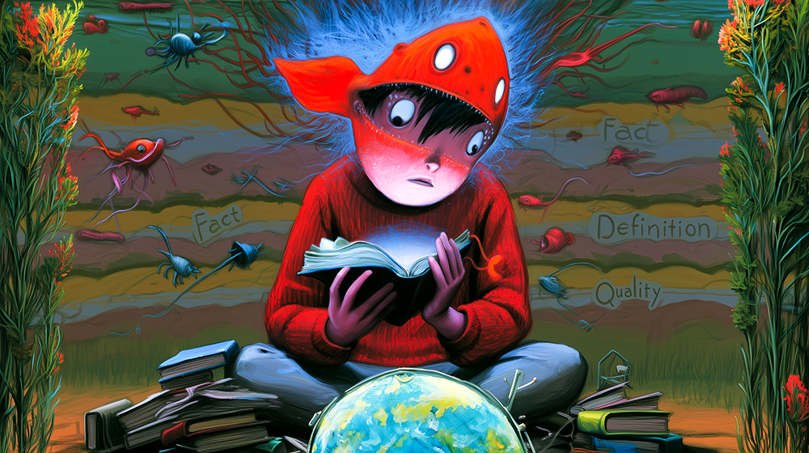

# Stasis

**Find out what your disagreement is really about, and whether you're arguing it there.**

A Claude skill for researchers and writers in the humanities and social sciences. For every disagreement your text takes on, it finds the kind of question the dispute turns on (fact, definition, cause, value or action) and checks that you meet your opponents on that question, rather than winning an argument nobody was having.

Built on the classical doctrine of stasis, as recast for academic writing by Jeanne Fahnestock and Marie Secor, with Cicero's *On Invention* for the point of dispute.

[Download `stasis.zip`](https://github.com/Halfofthesky/stasis/releases/latest/download/stasis.zip) · [View `SKILL.md`](stasis/SKILL.md)

---

## When you need it

- You're writing against **an established view** and want to be sure you're answering what its holders actually claim.
- A reviewer says you **"talk past" the literature**, or that your critics would simply not recognise their position in your summary.
- You're writing a **literature review** and need to see where a debate really divides, not just who sides with whom.
- Your argument makes a **value judgement** ("central", "flawed", "more radical") on a classification or a reading that others still dispute.
- You're told **"this isn't a question for your discipline"** and need to know what kind of objection that is.
- You want to see what a published argument is **really after** under its stated topic.

## Why you need it

Ancient rhetoric noticed that every dispute turns on one kind of question, and that each kind needs a different kind of argument. Fahnestock and Secor give five:

| Stasis | The question | Settled by |
|---|---|---|
| **Fact** | Did it happen? Does it exist? Will it happen? | Records, data, testimony |
| **Definition** | Granted the facts, what is it? Which category does it belong in? | Criteria applied to the case |
| **Cause** | What brought it about? What does it lead to? | Mechanisms, sequence, rivals ruled out |
| **Value** | Is it good or bad, central or minor? | Criteria of value the audience shares |
| **Action** | What should be done? | Consequences and obligations |

Cicero's example: everyone agrees a man stole a sacred vessel from a private place. The dispute is whether that is sacrilege or plain theft. No new evidence about the vessel will settle it; only a definition will. Academic arguments miss in the same way. They answer a dispute about definition with more facts, pass judgement on a classification still in doubt, or argue at length about meaning while what they really want readers to accept is a judgement of worth.

Each question also rests on the ones before it: you can't argue what something is worth until readers agree what it is. But Fahnestock and Secor show that this order follows the audience, not logic. What your readers already grant, you may assume. This skill judges every skipped step against the audience you're writing for.

## What it does

It reads your text and produces:

1. **A clash table**: each disagreement, quoted with its location, with your claim and your opponent's claim, the stasis of each, the question a neutral reader would have to settle, and whether the two sides actually meet on it.
2. **A profile**: the stasis your argument is pitched at and the stasis it's aimed at, and how the text moves between them section by section.
3. **A presupposition table**: the earlier questions your thesis depends on, and whether your readers treat each as settled, contested or unknown.
4. **The justification**: where the text says why this question is worth arguing, for these readers, or why it can take that for granted.
5. **Implications**: the judgements and actions readers in your field will draw from the argument, and whether you own them.
6. **Flags**, each with its location in the text:

| Flag | What it catches |
|---|---|
| S1 Missed clash | You answer an opponent on a different question from the one they raised |
| S2 Skipped stasis | Your thesis rests on an earlier question your readers still dispute |
| S3 Hidden aim | The argument is about one thing on the surface and another underneath, and the hidden claim gets no support |
| S4 Unjustified stasis | Nothing says why this question matters to these readers, and they won't assume it |
| S5 Wrong-stasis support | Evidence of one kind offered for a claim of another, with nothing linking them |
| S6 Unowned implication | Readers will draw a judgement you neither argue nor disclaim |
| S7 Jurisdiction missed | An objection about method, discipline or standing is answered as if it were about facts |
| S8 Lumped opponents | Critics who disagree for different reasons are answered in one go |
| S9 Ambiguous stasis | Two readings of what a claim is about, with both given |

7. **Moves**: which question to argue first, how to restate a claim so it meets the opponent, what to say openly about your aim, and what each change will cost you.

It knows disciplinary norms. A scientific paper that assumes its question is worth asking isn't flagged for it, and literary criticism that argues about meaning in order to argue about value is treated as doing what the genre does.

It **doesn't rewrite your text**, score your argument, or judge whether your claims are true.

## How to use it

Give Claude your text (or a section of it) and say what you want. Two modes:

- **Audit**: your own draft. *"Run a stasis check on this chapter. Am I meeting my critics where they are?"*
- **Read**: someone else's text, or several. *"Where does this article's disagreement with Smith really sit?"* or *"Here are four contributions to this debate. Map where they clash."*

It works on the disagreements your thesis depends on, and tells you which it chose. It works in any language.

**Tip:** say who your readers are: a subfield, a whole discipline, or general readers. What counts as settled depends on it, and the findings change with the audience.

## Install

**Claude (web and desktop):**
1. Download [`stasis.zip`](https://github.com/Halfofthesky/stasis/releases/latest/download/stasis.zip).
2. Go to **Customize → Skills → + → Create skill → Upload a skill**.
3. Choose the zip. Code execution must be on in **Settings → Capabilities**.

**Claude Code:** copy the `stasis/` folder into `~/.claude/skills/`.

**ChatGPT, Gemini or any other model:** the skill is a single plain Markdown file with no scripts. Download [`SKILL.md`](https://github.com/Halfofthesky/stasis/releases/latest/download/SKILL.md) and paste it into a custom GPT's instructions, a Gem, a project's instructions, or the start of a chat.

## Downloads

From the [latest release](https://github.com/Halfofthesky/stasis/releases/latest):

| File | For |
|---|---|
| [`stasis.zip`](https://github.com/Halfofthesky/stasis/releases/latest/download/stasis.zip) | Uploading to Claude |
| [`stasis.skill`](https://github.com/Halfofthesky/stasis/releases/latest/download/stasis.skill) | The same archive, `.skill` extension |
| [`SKILL.md`](https://github.com/Halfofthesky/stasis/releases/latest/download/SKILL.md) | Any other model, as plain text |

## Sources

- Jeanne Fahnestock and Marie Secor, "The Stases in Scientific and Literary Argument," *Written Communication* 5.4 (1988): 427–443.
- Cicero, *On Invention*, Book I, in the English translation on Wikisource.

The skill marks which source each rule comes from. Three flags are my own extension of the doctrine to written academic debate: S1 (missed clash) and S8 (lumped opponents) apply Cicero's account of the point of dispute, and S7 turns his objection to the court's jurisdiction into a separate axis. The skill is not affiliated with the authors.

## See also

- [BEAM](https://github.com/Halfofthesky/beam): maps what each source does in your text.
- [Concept Check](https://github.com/Halfofthesky/concept-check): tests whether a concept earns its place.
- [Evidence Tests](https://github.com/Halfofthesky/evidence-tests): weighs the evidence for causal claims against rival explanations.
- [Logic & Reasoning Skills](https://github.com/Halfofthesky/logic-reasoning-skills): reconstructs arguments, spots fallacies, solves formal logic.
- [Adversarial Editorial Review](https://github.com/Halfofthesky/adversarial-editorial-review): three reviewers and an editorial synthesis for humanities manuscripts.

## License

MIT
